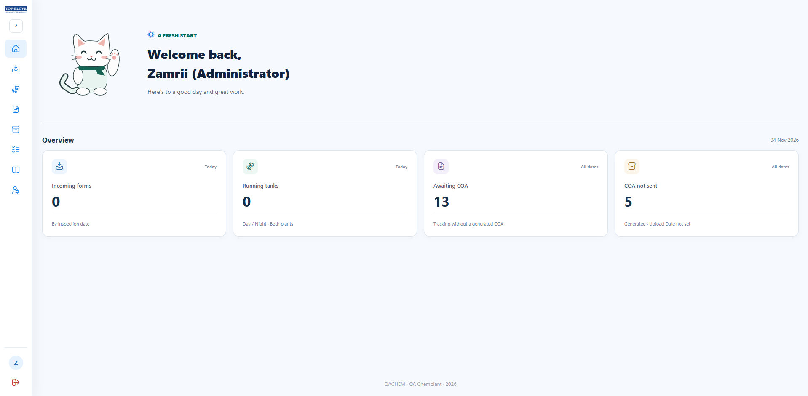
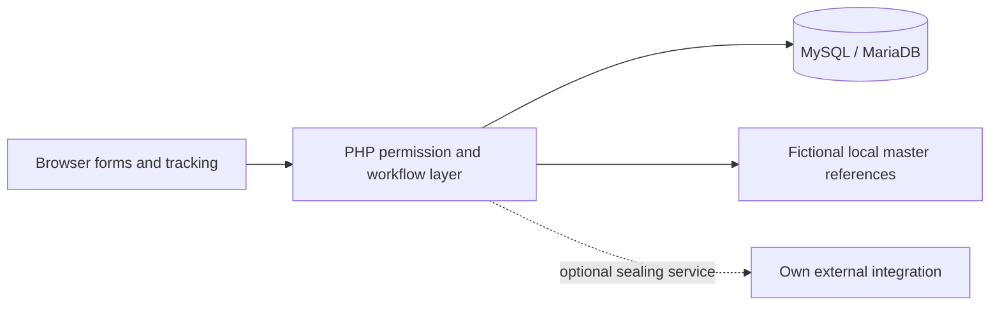

# QACHEM / QASS ChemPlant

Incoming-material and in-process testing, follow-up runs, product specifications, tracking records, and Certificate of Analysis views.

**Role:** Software Development Intern · Quality Assurance (IT)  
**Built with:** PHP, JavaScript, CSS, MySQL / MariaDB  
**Project:** Industry experience · 2026

## Overview

Chemical testing involves incoming materials, production readings, follow-up attempts, specifications, and reporting. QACHEM brings those records into connected forms and tracking views so the testing context remains understandable.

## My contribution

Built the system from scratch during my internship at Top Glove: laboratory interfaces, PHP endpoints, MySQL data handling, test-attempt workflows, tracking, COA output, debugging, and user acceptance testing.

**[Read the portfolio case study](https://zamri-portfolio.vercel.app/projects/qass-chemplant)** · **[Engineering decisions and verification](docs/engineering.md)**

## Features

| Capability | What it supports |
| --- | --- |
| Incoming materials | Liquid and powder testing forms with input validation, calculations, and saved records. |
| In-process testing | Plant, date, shift, tank, and product context connect repeated readings with the appropriate batch. |
| Follow-up attempts | Retest, rework, and new-sample runs retain a relationship to the original testing context. |
| Specifications | Product specifications and COA remarks provide the references used in related views. |
| Tracking | Batch planning, testing results, and COA-related status are presented in a common register. |
| Access control | Session permissions distinguish viewing, operational editing, and administrative access. |

## Workflow

An operator selects the relevant material or production context, records readings, and reviews the testing result. Follow-up attempts remain associated with the testing history. Tracking and COA views provide the reporting context around those records.

## Architecture

## Source guide

| Path | Responsibility |
| --- | --- |
| `app/` | Application configuration, authentication, calculations, and data services |
| `api/` | Permission-checked endpoints for forms, testing, specifications, and tracking |
| `assets/` | Browser JavaScript, styles, and interface assets |
| `migrations/` | Versioned database structure and migration history |
| `data/qachem_master.json` | Fictional demonstration master references |

## Portfolio export

This is a separate, cleaned source snapshot for code review. The working internal application remains untouched. Private configuration, credentials, uploaded evidence, operational logs, database files, backups, and employee-account utilities are excluded. This repository has no connection to company production systems by default.

## Local setup

Use Apache/PHP through XAMPP, or a PHP development server with the appropriate document root. This is a PHP application, so GitHub Pages cannot execute its backend.

1. Create an empty MySQL database named `qachem_demo`.
2. Copy `app/config.example.php` to `app/config.local.php` and configure your own database.
3. Run `php tools/migrate.php` against that local database only.
4. Supply your own local `m_user` account. Production accounts are not included.
5. Open `login.php`.

`data/qachem_master.json` contains fictional plants, products, materials and limits. It is illustrative software data, not a chemical-testing reference. The sealing-sheet integration needs your own service endpoint and is intentionally unconfigured.

Entry point: `login.php`. A local database, your own login accounts, and optional external integrations must be configured before an end-to-end walkthrough. Setup instructions are a starting point; this export has been syntax-checked, not validated against a live company environment.

## Repository contents

The application source, styles, JavaScript, local interface assets, empty-table SQL where supplied, and example connection settings are included. No inspection history, employee lists, or database dumps are bundled. Runtime directories are ignored by Git.

## Development status and limitations

This is internship project work presented for review, not a hosted production service or a claim of commercial deployment. Original application code is retained except for configuration/data sanitisation and standalone packaging. No measured efficiency improvement is claimed.

## Rights

No open-source licence is granted by this export. Application and third-party assets retain their respective ownership and licence terms. Company source may be shared only within the owner's authorised scope.

## Author

[Muhammad Zamri Bin Hamzah](https://github.com/zmrii22) · Software Engineering undergraduate, Universiti Malaysia Terengganu.
