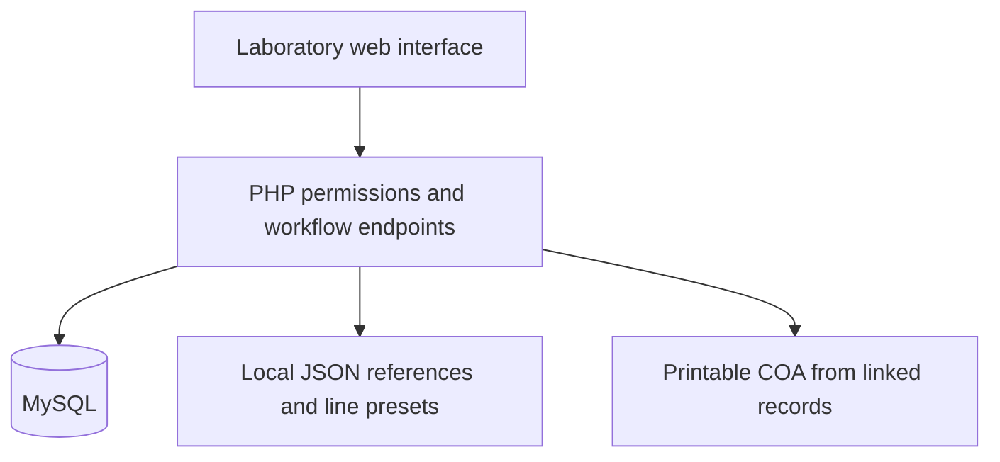

# Engineering notes — QACHEM / ChemPlant

Built from scratch by Muhammad Zamri Bin Hamzah during a Software Development internship at Top Glove: laboratory interfaces, PHP endpoints, calculations and validation, MySQL persistence, tracking and printable COAs.

## Architecture



The public snapshot uses fictional reference data and requires local database configuration. It has no automatic connection to workplace systems.

## Decision: give testing attempts an exact identity

**Problem:** An original run, retest, rework and new sample can share a tank/product. A lookup by those labels alone can mix readings from different attempts.

**Implementation:** Save follow-up attempts separately and restore readings by the exact batch/run identity. Preserve earlier results rather than overwriting them when a new attempt is created.

**Trade-off:** Summaries and restore logic must distinguish saved originals, saved follow-ups, and unsaved entries. A stale or duplicate form cannot be treated as the latest shared run.

Source: [`app/InprocessRuns.php`](../app/InprocessRuns.php), [`app/InprocessRunStorage.php`](../app/InprocessRunStorage.php), [`api/inprocess_followup.php`](../api/inprocess_followup.php).

## Decision: link COAs to their source data

**Problem:** Copying readings into a report record introduces a second set of values that may diverge.

**Implementation:** Tracking retains a source link. COA output reads the linked in-process results and current specifications when it is generated.

**Trade-off:** This is a live generated view, not an archived revision system. A user-exported PDF captures the values at that time.

Source: [`app/Tracking.php`](../app/Tracking.php), [`app/TrackingStorage.php`](../app/TrackingStorage.php), [`COAForm.php`](../COAForm.php).

## Decision: enforce permissions on the server

Page and API checks distinguish viewing, operational editing and administrative tasks. A hidden button alone is not treated as an access boundary.

Source: [`app/bootstrap.php`](../app/bootstrap.php), [`api/inspection.php`](../api/inspection.php), [`api/tracking.php`](../api/tracking.php).

## Verification guide

Run syntax checks without a database connection:

```sh
php -l app/InprocessRuns.php
php -l app/InprocessRunStorage.php
php -l app/Tracking.php
php -l COAForm.php
```

After following the README's local setup, use fictional records to check:

1. Save an original run, create a retest, and reopen both; their readings must stay separate.
2. Reload a saved batch and check plant/date/shift/tank/product context.
3. Open two forms for the same run and confirm stale-form handling before saving.
4. Check PASS/FAIL/PENDING with complete, failing and missing readings.
5. Generate a COA and compare it with the linked in-process record.
6. Check direct API access with viewing, operational and administrative accounts.

This checklist is intended for your isolated local environment. The cleaned export does not bundle the private application's regression suite or claim measured production productivity gains.
